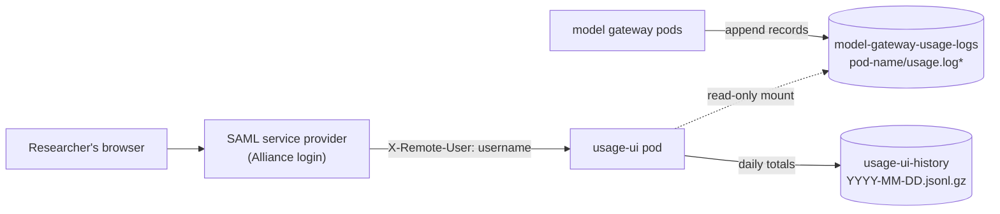

# Aleph usage UI

A small website where a researcher signs in and sees their own Aleph usage, with a CSV download. It has four pages, each for any date range:

| Page | Shows |
|---|---|
| Overview (`/`) | Totals for tokens (input, output, and thinking where reported), requests, estimated GPU-hours, and model wake-ups; the change from the previous period of the same length; charts by day, or by week for ranges over 62 days; a short per-model table. |
| Models (`/models`) | Per-model tokens, thinking, GPU-hours, latency, and errors; observed output speed; the largest prompt as a share of the model's context window, with a warning at 90%; requests by endpoint. |
| Errors (`/errors`) | Failed requests grouped by status, with a plain-language meaning and the models affected. |
| Report (`/report`) | A ready-to-copy sentence for grant and progress reports, a summary table, and a print layout for saving as PDF. |

The page starts in the light theme with serif text. Two icon buttons in the header switch between light and dark and between serif and sans-serif. One small script, `site.js`, keeps each choice in the browser's local storage. It also adds a copy button to the report's sentence, and shows a chart bar's figures as soon as the pointer is on it (the bar, if hatched, turns gold). Everything else is rendered on the server; without JavaScript these buttons are hidden and the defaults apply.

It reads the gateway's usage ledger directly (see [Logging and metrics](../docs/LOGGING.md)). It never writes to the ledger volume. It has no database: besides memory, its only state is a daily history of usage totals, one small gzipped file per day kept for a year (see [Daily history](#daily-history)), so usage stays visible after the ledger rotates it away.

**Status:** built and tested against synthetic ledgers only. Not deployed or validated against the production ledger.

## How it works



- Every 60 seconds (configurable) the service reads new lines from every `usage.log` and `usage.log.N` under the ledger root, one directory per gateway pod. It tracks each file by inode, so rotation never double counts, and it waits for a line's newline before counting it.
- Usage is held per file. When rotation deletes a file, its usage leaves the page too, so the page shows what the ledger still holds and states that range.
- Records count as complete only from a computed start date. Each pod's directory that may have lost a rotated file contributes the oldest record it still holds, and the latest of those is the start. An old retired pod directory therefore cannot make a range look complete after the live pods have rotated those days away. Set `USAGE_LOG_BACKUPS` to the gateway's `GATEWAY_USAGE_LOG_BACKUPS` to make this exact. Without it, any rotated file is treated as a possible loss, which can understate coverage. This assumes files leave the ledger only through the gateway's rotation: deleting or pruning a pod directory by hand, or records the gateway could not write to the file (its fallback is the process log), leave gaps the service cannot see. A directory or file that cannot be read is kept at its last known state, not dropped, and the pages say records could not all be read. A file the gateway deletes leaves the report after it has been missing from two refreshes in a row, because a rotation in progress can hide a file from a single refresh. Malformed ledger lines are skipped, and the service logs how many (never their content).
- Endpoints are shown by name when they are the gateway's own routes or the standard OpenAI-compatible paths. A model's own route, such as `/v1/science/predict`, is named once a request to it has succeeded (at most 256 such names); after that, failed requests to it are counted under it. Anything else counts as `other`, so made-up paths cannot create unlimited rows.
- Only records with `identity_type: user` are shown, matched on `identity`. Service keys such as the browser chat's are never shown to anyone.
- Cold-start guard records (`cold_start: true`, status 503) are counted as model wake-ups, not requests, following [LOGGING.md](../docs/LOGGING.md). A wake-up is an attempt that found the model not running; it includes refusals when no capacity was free, so it does not prove a model started.

The data source is a Go interface (`ledger.Source`). A central-logging source can replace the file reader later without touching the web layer.

### Daily history

The gateway's ledger rotates, so on its own it holds only a few weeks. To keep a year, the service saves each day's totals once the day is over:

- After each ledger refresh, on the same goroutine, it looks for days that are over, fully held by the ledger, within the retention period, and not saved yet. A day counts as over once a refresh has *started* at least 5 minutes after its midnight (UTC), so a slow refresh that began before midnight cannot save the day it was still reading. Each such day is written once to `USAGE_HISTORY_DIR/YYYY-MM-DD.jsonl.gz`: one JSON line per user, model, and endpoint, holding the same counts the pages show (requests, tokens, GPU time, errors by status, speed and context figures). No prompts or content. A day with no usage gets an empty file, so "saved" and "no usage" differ.
- A day is never saved while the ledger is loading, could not be read in full, or holds that day only in part, so a saved day is complete for good. Files are written under a temporary name, synced, and renamed, and the directory is synced, so a crash cannot leave a half-saved day. A saved day is not rewritten.
- A file that cannot be read, for any reason, counts as not saved. If the ledger still holds that day in full, the day is saved again over it; otherwise the file stays until the retention period removes it, and the day shows as incomplete.
- Each day is complete or not on its own: a day is complete when the ledger holds it in full or it was saved. Pages use a saved day in place of the ledger's partial rows, and mark only the days that are neither, wherever they fall in the range.
- Once a day, files older than `USAGE_HISTORY_DAYS` (default 366) are deleted, going by the dates in the file names. Nothing else deletes them.
- At startup the service creates the history folder if needed (mode `0700`; files are `0600`, since they hold every user's totals) and writes and removes a test file. If it cannot write there, it does not start. The Deployment mounts the claim at `/var/lib/usage-ui` and keeps the history in a `history` folder inside it, because the claim's own root keeps whatever mode the storage provisioner gave it.
- Size on disk is negligible: a year for 200 active users, each using 3 model and endpoint pairs every day, measured under 20 MB with deliberately hard-to-compress synthetic figures. Memory use is under [Limits](#limits).
- Only one process may write a history directory. The Deployment runs one replica with the `Recreate` strategy on its own claim.
- History starts when the service is first deployed with it. Usage the ledger had already rotated away before then cannot be recovered.
- Read a saved day with `zcat 2026-11-04.jsonl.gz`.

#### Remove one person's saved totals

Saved days keep each user's totals for the retention period, including users who have left. To remove one user's lines before then, stop the service so nothing writes the folder, rewrite each day file without that user's lines, and start it again. Usernames are plain ASCII, so the match is exact. The loop stops at the first file it cannot read, and keeps each new file private and owned by the service's user (65532). For a fictitious `example-user`:

```bash
# In the history folder, as root, with the usage-ui pod stopped.
set -eu -o pipefail
umask 077
for f in *.jsonl.gz; do
  zcat "$f" | { grep -v '"user":"example-user",' || true; } | gzip > "$f.new"
  zcat "$f.new" > /dev/null          # the new file reads back
  chown 65532:65532 "$f.new"
  mv "$f.new" "$f"
done
```

Days the ledger still holds keep showing that user's usage from the ledger until it rotates away.

## Run locally

Requires Go 1.27 or newer (pinned toolchain: go1.27.4). No other dependencies.

```bash
cd usage-ui
go run ./cmd/fakelogs -out ./devdata          # synthetic ledger, 21 days, users alice/bob/carol
USAGE_LOG_ROOT=./devdata \
AUTH_MODE=dev AUTH_DEV_ALLOW=yes-this-is-not-production AUTH_DEV_USER=alice \
go run ./cmd/usage-ui
# open http://localhost:8080
```

To see the daily history fill in days the ledger has rotated away, also generate the totals the service would have saved, and point it at them:

```bash
go run ./cmd/fakelogs -out ./devdata -days 30 -backups 3 \
  -history-out ./devhistory -history-days 20
USAGE_LOG_ROOT=./devdata USAGE_LOG_BACKUPS=3 \
USAGE_HISTORY_DIR=./devhistory USAGE_HISTORY_DAYS=20 \
AUTH_MODE=dev AUTH_DEV_ALLOW=yes-this-is-not-production AUTH_DEV_USER=alice \
go run ./cmd/usage-ui
```

`devdata/` and `devhistory/` are ignored by Git.

On Windows PowerShell, set the variables with `$env:NAME = "value"` first.

## Tests

CI runs these checks on pull requests, and on pushes to `main`, that change `usage-ui/` ([workflow](../.github/workflows/usage-ui.yml)). To run them locally:

```bash
cd usage-ui
gofmt -l .                      # prints nothing when formatting is clean
go vet ./...
go vet -tags proxycheck ./...
go test -count=1 ./...
```

CI also runs the tests with the race detector, `go test -race -count=1 ./...`. That needs cgo and a C compiler, which Linux and macOS usually have and Windows usually does not: without one, every package fails with `runtime/cgo: ... exit status 2` before any test runs. On Windows, run the race tests in Docker instead (one line, so it works in PowerShell and in Bash):

```bash
docker run --rm -v "${PWD}:/src:ro" -w /src -e GOFLAGS=-buildvcs=false golang:1.27.4 go test -race -count=1 ./...
```

The test for rotation by inode runs only on Linux and other Unix systems; on Windows the reader tracks files by path, which is enough for generated logs.

## Configuration

| Variable | Default | Meaning |
|---|---|---|
| `USAGE_LOG_ROOT` | `/var/log/aleph-usage` | Mount point of the usage-ledger claim (its root, not one pod's directory) |
| `LISTEN_ADDR` | `:8080` | HTTP listen address |
| `REFRESH_INTERVAL` | `60s` | How often to read new ledger lines (at least `1s`) |
| `USAGE_HISTORY_DIR` | empty | Directory for the [daily history](#daily-history), on its own writable volume. Empty turns the history off, and the pages show only what the ledger holds |
| `USAGE_HISTORY_DAYS` | `366` | Days of daily history to keep |
| `USAGE_LOG_BACKUPS` | `0` | The gateway's `GATEWAY_USAGE_LOG_BACKUPS`, the number of rotated files it keeps. `0` means unknown: any rotation is treated as a possible loss of older records |
| `AUTH_MODE` | `header` | `header` for production, `dev` for local testing |
| `AUTH_HEADER` | `X-Remote-User` | Header carrying the authenticated username |
| `AUTH_REALM` | empty | The one realm accepted in `user@realm` values, for example `ualberta.ca`: `user@ualberta.ca` becomes `user` (the realm is matched without regard to case) and any other realm is refused. Empty accepts bare usernames only. Usernames must be ASCII. Setting the removed `AUTH_STRIP_REALM` stops the service from starting |
| `AUTH_TRUSTED_PROXIES` | empty | Comma-separated CIDRs or addresses of the SAML proxy; only these peers may send the identity header. Catch-all ranges (`0.0.0.0/0`, `::/0`) are refused |
| `AUTH_ALLOW_ANY_PEER` | empty | `yes-networkpolicy-admits-only-the-proxy` to accept the header from any peer, for a proxy without stable addresses. Use only with the NetworkPolicy applied |
| `AUTH_DEV_USER` | `alice` | Dev mode only: the user every request is signed in as |
| `AUTH_DEV_ALLOW` | empty | Dev mode refuses to start unless this is `yes-this-is-not-production` |
| `SITE_TITLE` | `Aleph` | Name shown in the header |

## Authentication

The app does not speak SAML. A SAML service provider in front of it (for example `mod_auth_mellon`, Shibboleth SP, or an SSO proxy registered with the Alliance IdP) authenticates the user and forwards the request with the username in `X-Remote-User`. The username must be the LDAP name that the Vulcan PAM hook uses as the Tyk key alias, which is the `identity` in the ledger.

This repository does not supply or configure that proxy. The app trusts the header, so its safety depends on two things outside it:

- **The proxy sets the header itself.** It requires sign-in on every path, removes any `X-Remote-User` the client sent, and only then sets it from the SAML attribute. Otherwise a user can type someone else's name into the header.
- **Only the proxy can reach the pod.** Otherwise anything in the cluster that reaches the pod, including model servers in the same namespace, can send any name.

The app enforces what it can. In `header` mode it refuses to start until either `AUTH_TRUSTED_PROXIES` lists the proxy's addresses or `AUTH_ALLOW_ANY_PEER` confirms that a NetworkPolicy restricts access. It also rejects a request whose header is missing, repeated, or not a valid username. It cannot see how the proxy is configured, so the [proxy check](#verify-the-proxy) tests that from outside.

Usernames must match `^[a-z_][a-z0-9._-]{1,31}$` (the PAM hook's rule); anything else is rejected. No page or download accepts a username from the URL or form.

## Deploy

1. Build and push the image from this directory and pin it by digest: `docker build -t rkhoja/aleph:usage-ui-<sha> .`
2. Set the image in [deploy/k8s/deployment.yaml](deploy/k8s/deployment.yaml). Set `AUTH_TRUSTED_PROXIES` or `AUTH_ALLOW_ANY_PEER`; the pod does not start until one is set.
3. Set `USAGE_LOG_BACKUPS` to the deployed gateway's actual rotation count. The manifest deliberately leaves it unset because that count has not been verified: the gateway's source default is `GATEWAY_USAGE_LOG_BACKUPS=5`, but [Storage and retention](../docs/LOGGING.md#storage-and-retention) reports that the deployed image keeps only one rotation. Read the value from the running gateway (its environment, or the highest `usage.log.N` that ever appears in a live pod's directory) rather than assuming either figure. Unset is safe but conservative: every rotation counts as a possible loss, so the pages may call some complete days incomplete. A value higher than the real count is not safe, because a pod that has already deleted files would be treated as having lost nothing.
4. Replace the `<...>` placeholders in [deploy/k8s/networkpolicy.yaml](deploy/k8s/networkpolicy.yaml) with the proxy's namespace and pod labels. Apply the history claim [deploy/k8s/pvc.yaml](deploy/k8s/pvc.yaml) first, then the NetworkPolicy, the Deployment, and [deploy/k8s/service.yaml](deploy/k8s/service.yaml). Never delete the history claim: the days it holds cannot be rebuilt.
5. Configure the SAML service provider in front of the Service, as described in [Authentication](#authentication).
6. Run the proxy check below. The deployment is not finished until it passes.

### Verify the proxy

[deploy/proxycheck](deploy/proxycheck/) is a test that **fails until the proxy is configured correctly**. It is excluded from `go test ./...` and from the image build by the `proxycheck` build tag. Run it from any machine that can reach the public URL:

```bash
cd usage-ui
export USAGE_UI_URL=https://usage.example.org   # the public URL
export USAGE_UI_EXPECT_USER=yourname            # your own username
# Sign in through the proxy in a browser, then copy the Cookie request header
# for the usage UI from the browser's developer tools. Keep it out of shell
# history and logs; the test never prints it.
read -rs USAGE_UI_SESSION_COOKIE && export USAGE_UI_SESSION_COOKIE
go test -tags proxycheck -count=1 -v ./deploy/proxycheck/
```

It sends the made-up username `proxycheck-forged` in several forms: one header, two headers, your name and the forged name on one line, and an underscore spelling (`X_Remote_User`). It passes only if:

- without a session, every page (`/`, `/models`, `/errors`, `/report`) and the CSV get 401/403 or a redirect to another host (the IdP). A redirect to the usage UI's own host fails the check, because an http-to-https or trailing-slash redirect would pass otherwise; if your proxy's sign-in handler is on that host, confirm by hand that it leads to the IdP;
- with your session, every page and the CSV are yours and never the forged user's.

`USAGE_UI_URL` must be an `https` URL.

If the proxy uses another header name, set `USAGE_UI_AUTH_HEADER`. The check does not test the NetworkPolicy. To confirm it, try to reach the pod directly from another pod in `models`; the connection should time out.

The pod mounts `model-gateway-usage-logs` read-only at its root and runs as UID 65532 with a read-only root filesystem. Check that the ledger files and pod directories are world-readable on the NFS export (the gateway writes them as root, normally `0644` files in `0755` directories).

## Limits

- Without the [daily history](#daily-history), usage goes back only as far as the ledger's rotation keeps files, which depends on the deployed gateway's configuration (see [Storage and retention](../docs/LOGGING.md#storage-and-retention)). With it, days the ledger has rotated away still show in full for a year. Either way some days can have incomplete records: days from before the history started, past its retention, or ones it could not save (an unreadable file the ledger could no longer replace, or downtime longer than the ledger lasts). The pages show each such day, wherever it falls in the range, rather than only saying so:
  - The notice at the top draws the range as a green bar with a gold segment for each run of incomplete days, and lists them.
  - On the Overview, each total card carries an "Includes N incomplete days" badge.
  - Chart bars for incomplete days are faded and hatched, with a key; an incomplete day with no recorded usage still gets a short hatched bar.
  - The daily table highlights and tags incomplete rows.
  - The previous-period change is hidden unless every day of both periods is complete.
  - The report's sentence, summary table, and printed header cover only the complete days. Incomplete days at either end narrow the dates; ones in between are left out and counted ("excluding 1 day with incomplete records"), and the notice names them.
  - The CSV has a `records_complete` column (`yes` or `no`). Every incomplete day has a line, even one with no recorded usage, so a lost day and a day without usage can be told apart.

  The service cannot recover usage that rotated away before it saved the day.
- Ranges end today at the latest, and run at most 366 days. A date edited into the URL that is invalid, in the future, or out of order is quietly replaced by its default; the page and the CSV file name show the range actually used. The report statement covers finished days only, so it ends yesterday and says today is left out.
- Two unlikely cases are not handled, to keep the history simple:
  - If the ledger volume is recreated, its new records start fresh, and nothing has rotated yet, the days between the last saved day and the new ledger's first record show as complete although nothing is recorded for them.
  - If the gateway rotates a file in the instant between the service listing a pod's files and opening them, on the refresh that saves a day (usually the first after a restart), that day can be saved without part of a file's records. It stays short.
- Browser chat and other shared applications are recorded under their service key, so their end users' usage does not appear.
- Work done by jobs submitted to `/v1/tasks` is recorded under the gateway's task worker (`identity: task-worker`, a service identity), not the submitting user, so it does not appear either. Fixing that belongs in the gateway.
- GPU-hours are an estimate: the gateway's `derived.gpu_seconds`, which is the model's whole-GPU count (`nvidia.com/gpu`) × request latency, shown in hours. A model on a shared HAMi slice still counts as one full GPU, failed requests are included, and concurrent requests are each counted in full, so the figure overstates use of shared models. It is not measured utilization or a bill, and the report sentence says "an estimated". The CSV keeps `gpu_seconds_estimate` and adds `gpu_hours_estimate`.
- Thinking tokens come from `tokens.detail.completion_tokens_details.reasoning_tokens` (or `output_tokens_details`), which only some runtimes send. A model that never sends the field shows "not reported", not 0; a reported 0 means no thinking tokens were counted. In the CSV, `reasoning_tokens` is empty when no request reported it, and `reasoning_reported_requests` counts those that did. As checked on 2026-11-17, qwen38-27b and gemma-4-31b send it and gpt-oss-120b does not.
- Output speed is completion tokens divided by the latency of successful requests that produced output. Latency includes queueing and wake-up time, so it is observed speed, not a benchmark.
- The context-window figures need `context_window` in the record; models whose card declares none (image, audio) show a dash. Audio endpoints record no tokens and image endpoints only counts, so the endpoint table shows requests only for them.
- Error meanings are the usual cause for each status (for example 499: the client closed the connection; 502: the gateway could not reach the backend or it took too long, since the gateway reports its own upstream timeouts as 502). The gateway does not return 504 itself; one comes from a component in front of the model. The meanings were not traced through every gateway path, and the client's response has the exact reason.
- The service reads the whole ledger on start, and the startup probe allows 5 minutes for that. Load time and memory use on a real ledger have not been measured; a full year of daily history for 200 active users took about 100 MB in a synthetic test. The Deployment requests 256 Mi with a 512 Mi limit, and sets `GOMEMLIMIT` so Go collects garbage harder before reaching it. Run exactly one replica: the history directory must have one writer.
